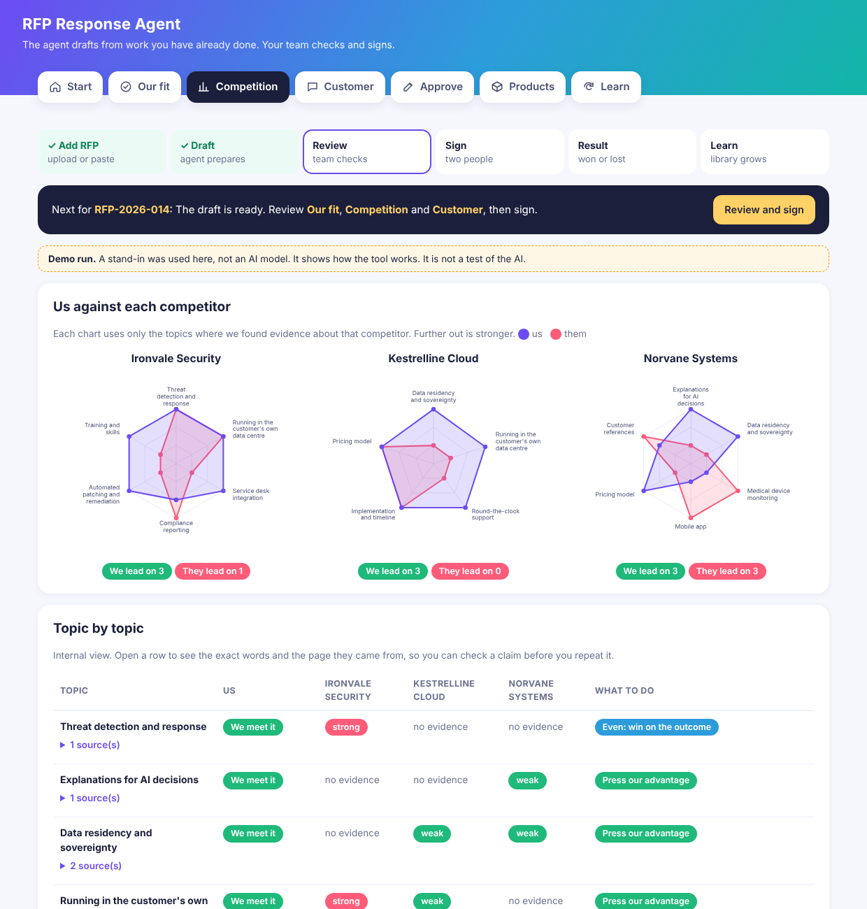

# RFP Response Agent

An AI agent that prepares the first draft of an RFP response from work your company has already done. The account team checks it, edits it and signs it off. Nothing reaches the customer until two people have approved it, and the tool cannot send anything itself.

It runs on one computer with open-source tools, so RFPs, past bids and competitive notes stay in-house.

**Everything in this repository is invented:** the vendor (Vantora Software), the customer, the three competitors, the past bids and the web pages about them.

## What it does

| Step | Who does it | What happens |
|---|---|---|
| 1. Read the RFP | Code, then AI | Code finds the numbered requirements. The AI says what each one is about. |
| 2. Position | Code | Looks the topic up in the product catalogue and sets the fit: meets, partly meets, or gap. The AI cannot change this. |
| 3. Reuse | Code, then AI | Finds the best past answers (won and recent bids rank higher). The AI drafts from them. |
| 4. Competition | AI, then code | The AI pulls claims about competitors from web pages. Code keeps a claim only if its quote is really in the page cited. |
| 5. Customer | AI, then code | The same, for what the customer has said in public about its priorities. |
| 6. Checks | Code | No invented numbers, no competitor or old-customer names in the response, no sales words, gaps admitted plainly. |
| 7. Approval | Two people | The technical consultant and the account lead both sign. Any edit clears the sign-offs. |
| Every six months | Code | Approved answers go into the library, with a report on what the team changed, won and lost. |

## Quick start (Windows)

1. Install Python 3.12 and Ollama (see [docs/SETUP_WINDOWS.md](docs/SETUP_WINDOWS.md)).
2. Double-click `start_windows.bat`. Your browser opens at http://localhost:8765.
3. On the Start page, press **Try it without AI (demo)** next to the demo RFP for a first look. Use **Prepare draft with AI** once Ollama is running.

The Start page also has buttons to add your latest RFPs and product or service spec sheets. A banner on every page tells you the one thing to do next.

No `pip install` is needed. The tool uses only what comes with Python.

## Status, honestly

- The checks, retrieval, approval and review are covered by 18 automated tests, all passing.
- The AI steps were built and tested with a stand-in reader, labelled MOCK. **They have not yet been run with a real model.** Do that on your own machine and record the result in [docs/TESTING_AND_RESULTS.md](docs/TESTING_AND_RESULTS.md).
- Live web search (SearXNG), Docker and Kubernetes files are written but not run end to end.

## Guides

- [Setup on Windows](docs/SETUP_WINDOWS.md)
- [Why these choices](docs/WHY_THESE_CHOICES.md)
- [Privacy and guardrails](docs/PRIVACY_AND_GUARDRAILS.md)
- [Testing and results](docs/TESTING_AND_RESULTS.md)
- [Putting it in a customer environment](docs/ADAPTING_TO_A_CUSTOMER.md)
- [Scaling: Docker and Kubernetes](docs/SCALING.md)

MIT licence. Repository: https://github.com/Hxlnd-Byte/rfp-response-agent
